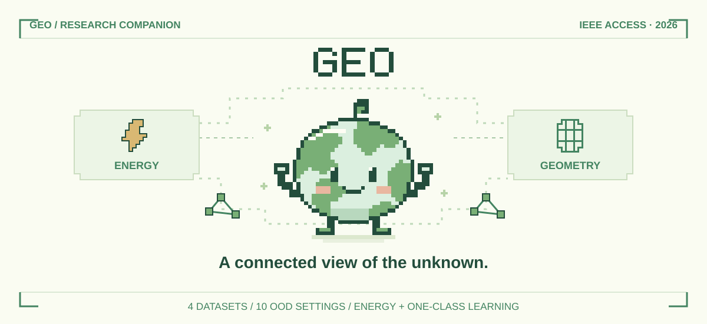
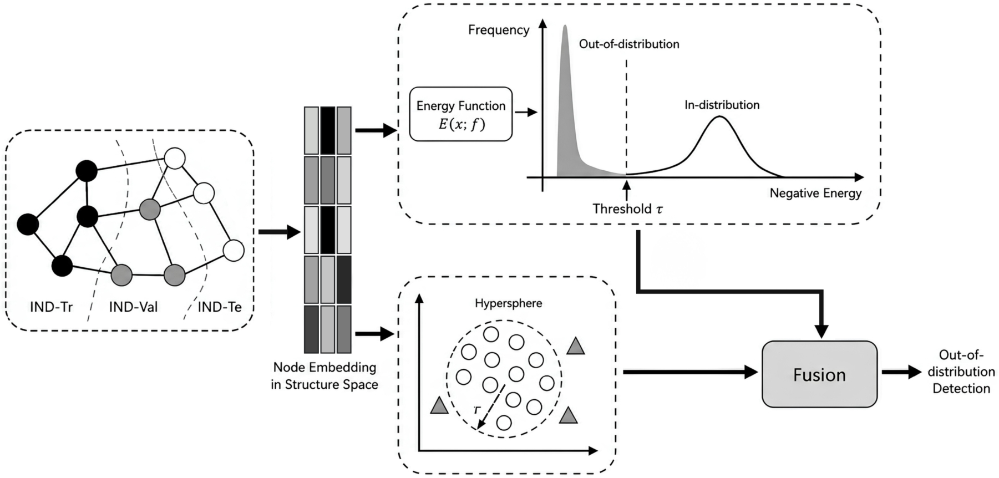
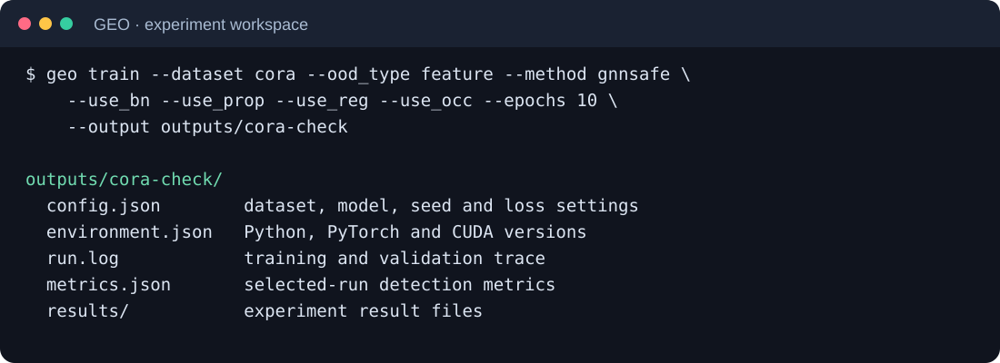

<p align="center"></p>

<h2 align="center">Graph Energy-Based Out-of-Distribution Detection</h2>
<p align="center"><strong>Research code for the GEO case study in our IEEE Access survey</strong></p>

<p align="center">
<a href="https://doi.org/10.1109/ACCESS.2026.3717452"></a>


<a href="LICENSE"></a>
</p>

<p align="center">
<a href="https://doi.org/10.1109/ACCESS.2026.3717452"><strong>Paper</strong></a> ·
<a href="#method">Method</a> · <a href="#results">Results</a> ·
<a href="#quickstart">Quickstart</a> · <a href="#experiments">Experiments</a> ·
<a href="docs/protocols.md">Protocols</a> · <a href="#citation">Citation</a>
</p>

<p align="center">
Mao Nguyen · Thien Pham · Long S. T. Nguyen · Dang Le · Trung M. Pham · Hieu M. Pham<br>
Duc Q. Nguyen · Xinh Le · Anh H. Huynh · Triet T. M. Le · Tho T. Quan<br>
<sub>URA Research Group, Faculty of Computer Science and Engineering<br>
Ho Chi Minh City University of Technology (HCMUT) · Vietnam National University Ho Chi Minh City</sub>
</p>

## Overview

**GEO** [1] connects three ideas for detecting unfamiliar nodes in graphs: **energy-based scoring**, **one-class geometry**, and **graph representation learning**. It is the illustrative experimental case study in *Conceptual Relationship Between Classical Machine Learning and Graph Neural Networks in Out-of-Distribution Detection: A Comprehensive Survey*.

The survey organizes connections between classical OOD principles and graph learning. This repository provides the GEO experiments: graph encoders, confidence and energy baselines, controlled OOD protocols, component ablations, and evaluation outputs.

- **Learn on graphs.** Encode node features and their neighborhoods with GCN, GAT, or GEN.
- **Shape the representation.** Combine classification, energy separation, and hypersphere compactness.
- **Evaluate distribution shifts.** Study structural, feature, label, and temporal OOD settings.

## Method

GEO trains a graph model with a weighted objective:

$$\mathcal{L}=\mathcal{L}_{\mathrm{NLL}}+\alpha\mathcal{L}_{\mathrm{energy}}+\beta\mathcal{L}_{\mathrm{one\text{-}class}}.$$

The classifier provides energy scores; the one-class objective encourages compact ID representations. Optional propagation aggregates scores through graph neighborhoods.

<p align="center">

<br><sub>Graph structure, energy scoring, and geometric compactness meet in one learning objective.</sub>
</p>

| Component | Role | Switch |
| :-- | :-- | :-- |
| Supervised classification | Learn discriminative ID representations | Always enabled |
| Energy regularization | Separate ID and exposed OOD energy distributions | `--use_reg` |
| One-class constraint | Encourage ID embeddings to occupy a compact hypersphere | `--use_occ` |
| Score propagation | Incorporate neighboring nodes into detection scores | `--use_prop` |

At inference, the energy-shaped logits provide the detection score. The CLI retains the experiment convention of **negative energy as ID confidence**: higher returned values indicate stronger ID evidence. See [method and code organization](docs/method.md) for equations, model construction, and score conventions.

## Results

The survey reports **AUROC (%)** across ten settings. The compact view below compares MSP, the GCN graph-energy configuration with propagation and energy regularization, and the strongest GEO configuration **with one-class learning enabled in each setting**. The final row selects across configurations; its complete variants are listed in the [results tables](results/README.md). **Bold** marks the highest value in each column.

| Configuration | Cora S | Cora F | Cora L | Photo S | Photo F | Photo L |
| :-- | --: | --: | --: | --: | --: | --: |
| MSP | 71.54 | 85.20 | 91.15 | 78.67 | 97.45 | 42.38 |
| GCN graph energy | **90.31** | 95.34 | 91.35 | 99.82 | **99.63** | 93.65 |
| Best GEO per setting | 90.24 | **95.51** | **94.44** | **99.99** | 98.84 | **98.05** |

| Configuration | CS S | CS F | CS L | arXiv temporal |
| :-- | --: | --: | --: | --: |
| MSP | 94.63 | 96.59 | 93.96 | 63.91 |
| GCN graph energy | **99.99** | **99.97** | **97.83** | 74.77 |
| Best GEO per setting | 99.94 | 99.92 | 97.10 | **86.36** |

**S** = structure manipulation, **F** = feature interpolation, **L** = label leave-out. Photo and CS denote Amazon-Photo and Coauthor-CS. These values are the survey's reported results; machine-readable values are in [`paper-auroc.csv`](results/paper-auroc.csv).

### Key findings

The case study illustrates how classical scoring and geometric constraints complement graph learning:

- **The temporal setting benefits most clearly.** GCN with all three components reaches **86.36 AUROC**, compared with **74.77** for the graph-energy configuration: **+11.59 points**.
- **Geometry can improve feature-shift detection.** On Cora feature interpolation, adding the one-class term reaches **95.51**, compared with **95.34**.
- **Configuration matters.** GEO variants lead **5 of 10 settings**; the strong graph-energy configuration leads the other **5**. The full tables make the backbone and objective choices explicit.

## Quickstart

Use Python 3.10+ and install a matching PyTorch / PyG extension stack. Install the following PyTorch / PyG stack on Linux with CUDA 12.8:

```bash
git clone https://github.com/longstnguyen/GEO.git
cd GEO
python3 -m venv .venv
source .venv/bin/activate

pip install torch==2.8.0 --index-url https://download.pytorch.org/whl/cu128
pip install torch_scatter torch_sparse --only-binary=:all: \
  -f https://data.pyg.org/whl/torch-2.8.0+cu128.html
pip install -e '.[dev]'
```

Run a short Cora experiment with all three GEO components:

```bash
geo train --dataset cora --ood_type feature --method gnnsafe \
  --backbone gcn --use_bn --use_prop --use_reg --use_occ \
  --m_in -7 --m_out -1 --lamda 0.1 --beta 0.1 \
  --epochs 10 --device 0 --output outputs/cora-check
```

Cora downloads on first use. The command saves the full console log, configuration, environment, and evaluation results. For CPU installation and longer runs, see the [running guide](docs/usage.md).

<p align="center">

<br><sub>One experiment directory keeps configuration, logs, and results together.</sub>
</p>

## Experiments

`--method gnnsafe` selects the shared energy-model implementation; adding `--use_occ` enables GEO's one-class term.

| Experiment | Command or script |
| :-- | :-- |
| Main dataset and component comparisons | [`scripts/run.sh`](scripts/run.sh) |
| ODIN, outlier-exposure and Mahalanobis baselines | [`scripts/run_baseline.sh`](scripts/run_baseline.sh) |
| Energy-margin and regularization sweeps | [`scripts/run_hyper_search.sh`](scripts/run_hyper_search.sh) |
| Backbone, margin, propagation and timing studies | [`scripts/run_discuss.sh`](scripts/run_discuss.sh) |
| Export ID/OOD score distributions | [`scripts/run_visualize.sh`](scripts/run_visualize.sh) |

Choose the GPU without editing the scripts:

```bash
GEO_DEVICE=0 bash scripts/run.sh
```

The scripts run multiple experiments sequentially. Each invocation gets its own directory under `outputs/`. Dataset downloads are shared through `data/`; use `--data_dir` for another cache location. See [experiment recipes](docs/usage.md#experiment-recipes) before launching a full sweep.

### Dataset protocols

| Dataset | Nodes | Features | OOD settings |
| :-- | --: | --: | :-- |
| Cora | 2,708 | 1,433 | Structure, feature, label |
| Amazon-Photo | 7,650 | 745 | Structure, feature, label |
| Coauthor-CS | 18,333 | 6,805 | Structure, feature, label |
| ogbn-arxiv | 169,343 | 128 | Temporal cohorts |

The [protocol guide](docs/protocols.md) gives the exact masks, year boundaries, exposure cohorts, and evaluation conventions used by the loaders. Additional Twitch and protein loaders remain available for the supplied diagnostics.

## Code organization

The package separates model construction, research computation, and experiment orchestration:

| Responsibility | Module |
| :-- | :-- |
| Command dispatch, output isolation, run metadata | [`cli.py`](src/geo_ood/cli.py) |
| Detector factory shared by experiment pipelines | [`factory.py`](src/geo_ood/factory.py) |
| Training and diagnostic orchestration | [`main.py`](src/geo_ood/main.py), [`discuss.py`](src/geo_ood/discuss.py) |
| GNN encoders and detection strategies | [`backbone.py`](src/geo_ood/backbone.py), [`baselines.py`](src/geo_ood/baselines.py) |
| Energy propagation and one-class learning | [`gnnsafe.py`](src/geo_ood/gnnsafe.py), [`loss.py`](src/geo_ood/loss.py) |
| Data protocols, metrics and result selection | [`dataset.py`](src/geo_ood/dataset.py), [`data_utils.py`](src/geo_ood/data_utils.py), [`logger.py`](src/geo_ood/logger.py) |

<details>
<summary><strong>Run implementation checks</strong></summary>

```bash
pytest -q
ruff check src tests
ruff format --check src tests
python -m build
```

</details>

## Citation

If you use this repository in connection with the survey, please cite:

Mao Nguyen, Thien Pham, Long S. T. Nguyen, Dang Le, Trung M. Pham, Hieu M. Pham, Duc Q. Nguyen, Xinh Le, Anh H. Huynh, Triet T. M. Le, and Tho T. Quan. **Conceptual Relationship Between Classical Machine Learning and Graph Neural Networks in Out-of-Distribution Detection: A Comprehensive Survey.** *IEEE Access*, volume 14, pages 119538–119566, 2026. [DOI](https://doi.org/10.1109/ACCESS.2026.3717452).

```bibtex
@article{11626139,
	title        = {{Conceptual Relationship Between Classical Machine Learning and Graph Neural Networks in Out-of-Distribution Detection: A Comprehensive Survey}},
	author       = {Nguyen, Mao and Pham, Thien and Nguyen, Long S. T. and Le, Dang and Pham, Trung M. and Pham, Hieu M. and Nguyen, Duc Q. and Le, Xinh and Huynh, Anh H. and Le, Triet T. M. and Quan, Tho T.},
	year         = 2026,
	journal      = {IEEE Access},
	volume       = 14,
	number       = {},
	pages        = {119538--119566},
	doi          = {10.1109/ACCESS.2026.3717452},
	keywords     = {Modeling;Signal detection;Energy;Graph neural networks;Learning (artificial intelligence);Machine learning;Conferences;Labeling;Training;Anomaly detection;Out-of-distribution detection;anomaly detection;graph neural networks;deep learning;statistical methods;machine learning survey;safety-critical applications}
}
```

## References

The case study builds on energy-based graph OOD detection and one-class learning. The supplied experiment code follows the [GNNSafe implementation](https://github.com/qitianwu/GraphOOD-GNNSafe) [2] in its baseline interfaces, protocols, and score propagation. Please also cite the relevant method when using these components:

[1] Mao Nguyen, Triet Le, Thien Pham, and Tho Quan, “[GEO: An Approach for Out-of-Distribution Detection in Graph Neural Networks Using Energy Scoring and One-Class Learning](https://doi.org/10.1007/978-3-031-74127-2_22)”, in _The 13th Conference on Information Technology and Its Applications_, Springer Nature Switzerland, pages 259–270, 2024.

[2] Qitian Wu, Yiting Chen, Chenxiao Yang, and Junchi Yan, “[Energy-based Out-of-Distribution Detection for Graph Neural Networks](https://openreview.net/forum?id=zoz7Ze4STUL)”, in _The Eleventh International Conference on Learning Representations_, 2023.

## License

Copyright © 2026 Long S. T. Nguyen. Repository code is distributed under the [MIT License](LICENSE). The research figures and reported results accompany the cited publications; benchmark datasets and external dependencies retain their respective terms and attribution.
