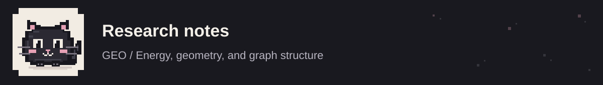

<p align="center"></p>

<p align="center"><a href="../README.md">← Overview</a> · <a href="usage.md">Running experiments</a> · <a href="method.md">Method</a> · <a href="protocols.md">Protocols</a></p>

# Running experiments

An experiment starts with a dataset protocol and detector configuration and ends in its own output directory. Install the environment in the [quickstart](../README.md#quickstart), then use `geo train` for evaluation or `geo discuss` for diagnostic studies.

## CPU installation

Use a fresh Python 3.10+ environment. The PyG extension wheels must match both the PyTorch version and its CUDA/CPU build.

```bash
pip install torch==2.8.0 --index-url https://download.pytorch.org/whl/cpu
pip install torch_scatter torch_sparse --only-binary=:all: \
  -f https://data.pyg.org/whl/torch-2.8.0+cpu.html
pip install -e '.[dev]'
```

Add `--cpu` to the training command. GPU runs select a device with `--device 0`.

## Experiment recipes

This example trains GEO on Cora feature interpolation for 200 epochs and repeats model initialization three times:

```bash
geo train --dataset cora --ood_type feature --method gnnsafe \
  --backbone gcn --hidden_channels 64 --num_layers 2 --use_bn \
  --use_prop --use_reg --use_occ --m_in -7 --m_out -1 \
  --lamda 0.1 --beta 0.1 --epochs 200 --runs 3 --seed 123 \
  --device 0 --output outputs/cora-feature
```

Use a new output path for each invocation. Dataset downloads remain in the shared `data/` cache. For another cache, pass `--data_dir /path/to/data`.

| Comparison | Arguments |
| :-- | :-- |
| MSP confidence | `--method msp` |
| Energy with propagation and regularization | `--method gnnsafe --use_prop --use_reg` |
| GEO with all three components | `--method gnnsafe --use_prop --use_reg --use_occ` |
| Outlier exposure | `--method OE` |
| ODIN | `--method ODIN --T 1000 --noise 0.001` |
| Mahalanobis | `--method Mahalanobis --noise 0.001` |

Detector names are case-sensitive. The main encoder choices are `gcn`, `gat`, and `gen`; the supplied backbone study also includes `mlp`, `gcnjk`, `gatjk`, and `mixhop`.

The five [experiment scripts](../scripts) retain the source experiment grids. `run.sh` covers dataset/component combinations; `run_baseline.sh` covers confidence baselines; `run_hyper_search.sh` sweeps margins and weights; `run_discuss.sh` covers diagnostics; `run_visualize.sh` exports score distributions. Read the selected script before launching its full grid.

```bash
GEO_DEVICE=0 bash scripts/run.sh
```

## Important arguments

| Argument | CLI default | Meaning |
| :-- | :-- | :-- |
| `--epochs`, `--runs` | `200`, `1` | Epochs per initialization and repeat count |
| `--seed` | `123` | Random seed for data generation and initialization |
| `--hidden_channels`, `--num_layers` | `64`, `2` | Encoder dimensions |
| `--dropout`, `--use_bn` | `0.0`, disabled | Dropout and batch normalization |
| `--lr`, `--weight_decay` | `0.01`, `0.01` | Adam settings |
| `--lamda`, `--beta` | `1.0`, `1.0` | Energy and one-class loss weights |
| `--nu` | `0.01` | One-class outside-sphere penalty control |
| `--K`, `--alpha` | `2`, `0.5` | Propagation depth and residual weight |
| `--T` | `1.0` | Score temperature |

Scripts pass their own overrides. `geo train --help` lists every option. In the paper's objective, the energy weight is written as alpha; its CLI name is `--lamda`. CLI `--alpha` controls propagation.

## Diagnostic outputs

Export ID and OOD score distributions at the epoch with lowest validation loss:

```bash
geo discuss --dataset cora --ood_type feature --method gnnsafe \
  --use_bn --use_prop --use_reg --use_occ --epochs 200 \
  --dis_type vis_energy --output outputs/cora-scores
```

Other `--dis_type` values are `margin`, `lamda`, `prop`, `backbone`, and `time`.

## Run artifacts

| File | Contents |
| :-- | :-- |
| `config.json` | Parsed experiment arguments |
| `environment.json` | Runtime versions, CUDA build, command and data location |
| `run.log` | Console training and evaluation trace |
| `metrics.json` | Selected metrics for each initialization |
| `results/` | Text reports and diagnostic score exports |

Detection metrics are percentages. Each row in `metrics.json` contains an AUROC/AUPR/FPR95 triple for each OOD test cohort, followed by the ID test score. Classification mode stores one validation-selected test score per initialization. These artifacts keep new measurements separate from the [published comparison](../results/README.md).

<p align="center"><a href="../README.md">← Overview</a> · <a href="usage.md">Running experiments</a> · <a href="method.md">Method</a> · <a href="protocols.md">Protocols</a></p>
